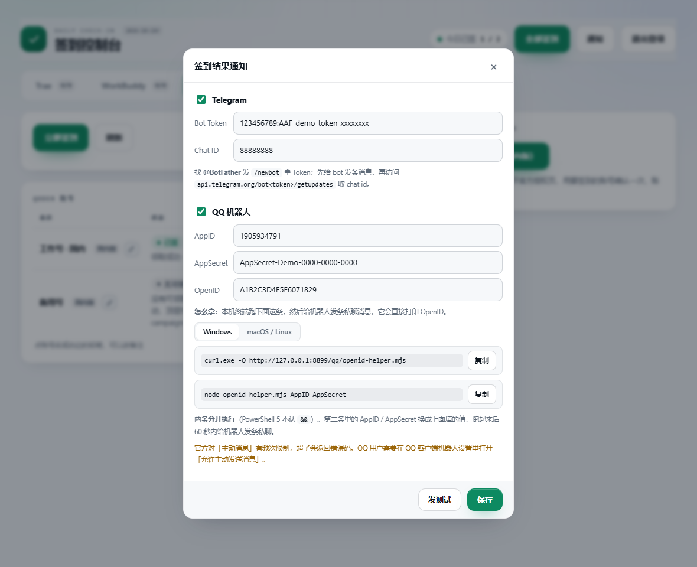

# Trae + WorkBuddy + Qoder 每日签到 · Cloudflare Worker

把三个平台的每日签到搬到云端：**不用开电脑、不用装客户端、不用守时间**。各登录一次把账号托管进去，之后 Worker 自己续期令牌、按时签到。

全部代码在 `worker.js` 一个文件里，没有构建、没有依赖，粘进 Cloudflare 网页控制台就能跑。

|        | Trae    | WorkBuddy | Qoder           |
| ------ | ------- | --------- | --------------- |
| 加账号    | 抖音扫码    | 微信扫码      | 官网设备授权（国内版）     |
| 签到内容   | 每日积分领取  | 每日签到      | 每日活动领取（credits） |
| 列表额外信息 | 余额、本次到账 | 连签天数、本期累计 | 本次到账、累计领取       |

三个平台共用一套部署、一个 KV，数据按 `trae:` / `wb:` / `qoder:` 前缀隔离。

---

## 一、部署

全程在 Cloudflare 网页控制台完成，不用装工具、不用命令行。

1. [Cloudflare Dashboard](https://dash.cloudflare.com/) → **Workers & Pages** → **Create**，起个名字（如 `signin-all`）
2. 点 **Edit code**，把 `worker.js` 全文粘进去 → **Deploy**
3. 回 Worker 设置页，加这几个绑定：

| 类型              | 名称            | 值                                            |
| --------------- | ------------- | -------------------------------------------- |
| KV Namespace 绑定 | `KV`          | 先到 **Storage & Databases → KV** 建一个命名空间，回来选中 |
| Secret          | `MASTER_KEY`  | 32 字节随机值的 base64，用来加密所有令牌                    |
| Secret          | `ADMIN_TOKEN` | 你自己定的**页面登录密码**                              |

生成主密钥：浏览器 F12 → Console 里跑

```js
btoa(String.fromCharCode(...crypto.getRandomValues(new Uint8Array(32))))
```

> 结果一定是 **44 个字符、以 `=` 结尾**。`MASTER_KEY` 丢了 = KV 里的令牌全解不开，只能重新扫码，**存进密码管理器**。

1. **Settings → Triggers → Cron Triggers** 加一条：`10 0 * * *`（北京 08:10）

---

## 二、添加账号

打开 `https://signin-all.<你的子域>.workers.dev`，输入 `ADMIN_TOKEN` 登录，然后按平台添加。

### Trae：抖音扫码

点「添加账号」→ 抖音扫码确认 → 浏览器会跳到一个**打不开的** `127.0.0.1` 页面（正常）→ 复制地址栏整段链接，回控制台粘到右侧输入框（粘贴即生效，不用点按钮）。


要注意的是：**粘的是扫码之后那个 `127.0.0.1:17388/...` 的地址**，不是前面授权页的地址——图里输入框的提示文字写的也是这个。

### WorkBuddy：微信扫码

点「添加账号」→ 新窗口打开官方登录页 → 微信扫码确认 → 账号自动出现，窗口自动关闭。二维码约 5–6 分钟有效。

> 官方登录页禁止被内嵌，所以是新窗口而不是弹窗内嵌。

### Qoder：国内版设备授权

点「添加账号（国内版）」→ 在新窗口登录并确认授权 → Worker 轮询到结果后自动入库。

## 三、控制台


顶栏「今日已签」是三个平台合计；「全部签到」三个平台一起跑；标签页分别管理，标签上的数字是当日已签数。


| 标签      | 含义                       |
| ------- | ------------------------ |
| 已签      | 今天签上了，下方显示到账金额           |
| 今日未签    | 还没跑，或还没到定时时间             |
| 无可领     | 接口通了但没有可领项，下方一行写明接口返回了什么 |
| 限流 N 分钟 | 服务端限流，已按账号冷却，到点自动重试      |
| 待确认     | 提交成功但没收到回执，下一轮再查         |
| 签到失败    | 请求出错，下方显示原因              |
| 令牌失效    | 登录态失效（改过密码、在别处登出），删掉重新添加 |

> 备注名优先取账号昵称，取不到时是 `Trae-xxxx` 这类占位名。点名字或右边的铅笔可以就地改名。
>
> 「累计」是本工具自己记的领取量，不是官网余额（这些接口不返回余额）。

---

## 四、定时任务

### 方式一：Cloudflare 自带的 Cron（推荐）

Cloudflare 的 Cron **只认 UTC**：

| 设置 | Cron         | 北京时间  | 作用       |
| -- | ------------ | ----- | -------- |
| 必设 | `10 0 * * *` | 08:10 | 三个平台各跑一遍 |

配置位置：Cloudflare 控制台 → Workers → 你的 Worker → **Settings → Triggers → Cron Triggers → Add**。

> 换算：**北京 = UTC + 8**。签到接口幂等，多跑几次不会重复加分。

### 方式二：外部定时器

#### 1. 先设口令

Cloudflare 控制台 → Workers → 你的 Worker → **Settings → Variables and Secrets**，加一个：

| 变量名           | 类型     | 值                                        |
| ------------- | ------ | ---------------------------------------- |
| `CRON_SECRET` | Secret | 随便一串长随机字符串，比如 `openssl rand -hex 24` 的输出 |

> 不设也行，会回退用 `ADMIN_TOKEN`。但单独设一个更安全——这样定时器口令泄露了不会连带后台也被登进去。

#### 2. 调用

有两种传口令的方式，任选一种：

**方式 A：请求头（推荐）**

```bash
curl -X POST https://你的域名/cron \
  -H "X-Cron-Secret: 你的CRON_SECRET"
```

**方式 B：URL 参数**

```bash
curl -X POST "https://你的域名/cron?key=你的CRON_SECRET"
```

方式 B 适合那些不方便自定义请求头的调度器（比如某些面板的「URL 定时任务」）。

#### 3. 接到各个调度器上

**Linux / macOS 的 crontab**（每天 08:10 北京时间）

```cron
10 8 * * * curl -s -X POST https://你的域名/cron -H "X-Cron-Secret: 你的CRON_SECRET" > /dev/null 2>&1
```

**Windows 任务计划**

```powershell
schtasks /Create /SC DAILY /ST 08:10 /TN "签到" /TR "curl.exe -s -X POST https://你的域名/cron?key=你的CRON_SECRET"
```


#### 4. 返回什么

```json
{
  "at": "2026-10-24 16:42:00 +08:00",
  "trae": { "accounts": 1, "checked": 1, "already": 0, "failed": 0, "results": [...] },
  "wb":   { "accounts": 1, "checked": 0, "already": 1, "failed": 0, "results": [...] },
  "qoder":{ "count": 2, "results": [...] }
}
```

各平台的 `results` 里每个账号带 `state` / `msg` / `lastCredit`。如果配了通知渠道，这里还会多一个 `notifyError`（仅当发送失败时出现）。

#### 5. 几个注意点

- **不会重复加分**：签到接口是幂等的，多调几次只是多跑几遍流程，已经领过的会显示「今日已签」。
- **同一次调用会串行跑三个平台**，整体耗时取决于账号数量，通常几秒。如果调度器有超时限制（比如 5 秒），调大一点。
- **口令错了返回 401** `{"error":"口令不对"}`；没配任何口令返回 500。
- **`/cron` 走的是 `force=false`**：账号在冷却期内、或今天已签，会直接跳过，不会硬刷接口。想强制重试用后台的「全部签到」按钮（它是 `force=1`）。

---

## 五、签到结果通知

点顶栏「通知」打开配置，两个渠道各自独立，填完点「发测试」就能立刻验证。



每轮跑完（定时任务或「全部签到」）推一条汇总，两个渠道各管各的，都不配就静默跳过。

### Telegram

1. 找 [@BotFather](https://t.me/BotFather) 发 `/newbot`，拿到 `123456:ABC...` → 填 **Bot Token**
2. 先给你的 bot 发一条消息，再打开 `https://api.telegram.org/bot<token>/getUpdates`，找 `"chat":{"id":123456789}` → 填 **Chat ID**

### QQ 官方机器人

到 [q.qq.com](https://q.qq.com) 建一个机器人，拿 **AppID** 和 **AppSecret** 填进页面。

**OpenID 用一个本机脚本拿**，不需要域名、不需要备案：

```bash
curl -O https://你的域名/qq/openid-helper.mjs && node openid-helper.mjs <AppID> <AppSecret>
```

（弹窗里有 **Windows / macOS·Linux** 切换，两条命令都按你当前系统准备好，点「复制」即可。Windows 用 `curl.exe`（PowerShell 里 `curl` 是 `Invoke-WebRequest` 的别名，不认 `-O`），macOS / Linux 用 `curl`。）

脚本会连上 QQ 的 WebSocket 网关，等你 60 秒——这期间用手机 QQ 给机器人发一条私聊消息，它就会把 `user_openid` 打印出来，然后自己退出。复制那串填进页面，保存。

### 通知长什么样

```
📋 签到完成 · 10-24 13:55
Trae  ✅ 1/1
   · 我的号 领取成功 +50 积分
WorkBuddy  ✅ 0/1 · 已签 1
Qoder  ⚠️ 1/2 · 失败 1
   · 备用号 没有可领取的活动
```

通道全部失败不影响签到结果，错误只会记在接口返回的 `notifyError` 里。

---

## 六、常见问题

| 现象                                     | 处理                                        |
| -------------------------------------- | ----------------------------------------- |
| 提示 `未配置 ADMIN_TOKEN` / `缺少 MASTER_KEY` | Secret 名字要**完全一致**，区分大小写                  |
| 提示 `MASTER_KEY 必须是 32 字节`              | 重新生成，确认 44 字符且以 `=` 结尾                    |
| 提示 `未绑定 KV`                            | KV 绑定名必须**完全等于** `KV`                     |
| 列表是空的                                  | 还没加账号，或 cron 还没到点                         |
| Trae 扫码后停在「无法访问此网站」                    | 正常，官网只回送 127.0.0.1，复制地址栏整段链接回来粘           |
| 粘贴后报「没找到 authCodeInfo」                 | 复制时漏了 `?` 后面的部分，重新全选地址栏                   |
| Trae 显示「限流 N 分钟」                       | 服务端限流，等冷却结束自动重试；再加一轮 cron 更容易补上           |
| Qoder 显示「无可领」                          | 看下面那行诊断：`返回 0 条` 多为当天没活动，`CLAIMED` 说明今天已领 |
| 删掉账号重新添加却直接是「已绑定」                      | 旧版本的问题，本版已修；已出现的点「解除绑定」重来                 |
| 一直没动静                                  | 检查 cron 是否配了，注意填的是 UTC                    |
| 令牌失效                                   | 改过密码或在别处登出，删掉账号重新添加                       |

排障时可以看 Worker 详情页的 **Logs**；Qoder 的细节用 `GET /qoder/api/inspect?id=<账号id>` 看，它会返回接口实际给了几条、分别是什么类型。

---

## 七、说明

**安全**：KV 里存的是 AES-256-GCM 密文（每条记录独立 salt + IV，密钥由 `MASTER_KEY` 经 HKDF 派生）；接口不返回任何令牌；登录密码和账号令牌分离，泄露密码不等于丢号。边界是：令牌在 Worker 内存里必然有一刻是明文，云端能看到什么取决于你是否信任它——介意就部署到自己账号下。

**限制**：三个平台的接口都是逆向得到的，客户端升级可能需要跟进适配；只做签到，没做成长期任务/兑换那套；扫码依赖官方登录页。

**风险**：本项目为非官方工具， Trae、WorkBuddy、Qoder 使用风险自负。建议只给自己的账号用，多账号大规模刷积分更容易触发风控。
