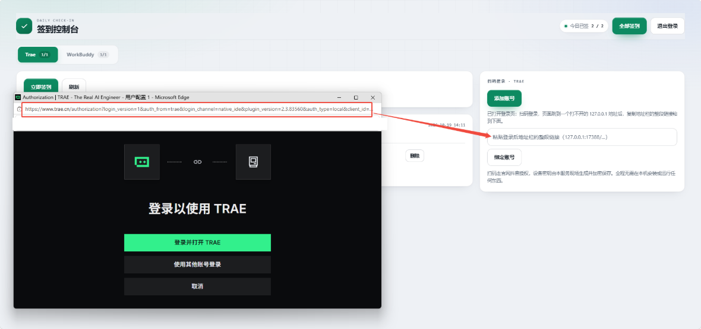
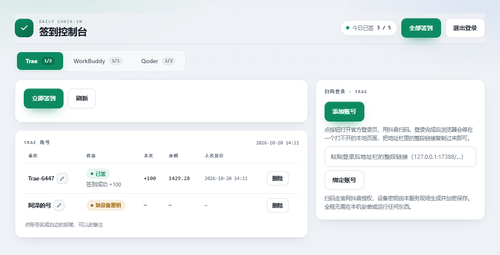
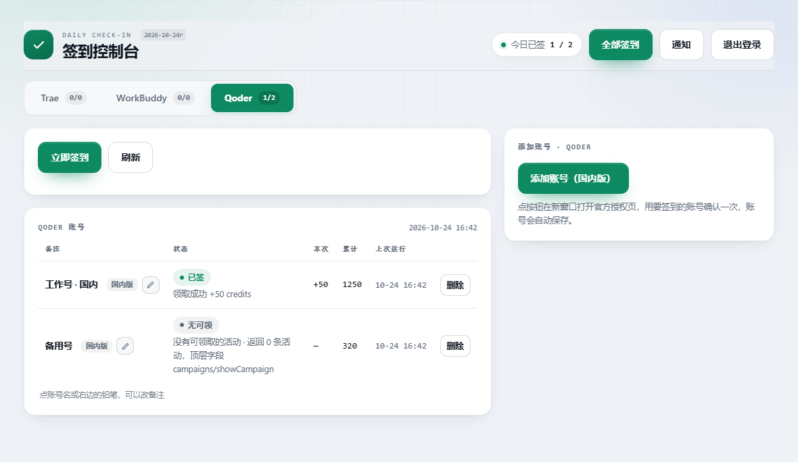

# Trae + WorkBuddy + Qoder + MiniMax 每日签到 · Cloudflare Worker

把四个平台的每日签到搬到云端：**不用开电脑、不用装客户端、不用守时间**。各登录一次把账号托管进去，之后 Worker 自动续期令牌、按时签到。

全部运行代码在 `worker.js` 一个文件里，没有构建、没有新增运行依赖，粘进 Cloudflare 网页控制台即可部署。

| | Trae | WorkBuddy | Qoder | MiniMax Code |
| --- | --- | --- | --- | --- |
| 加账号 | 抖音扫码 | 微信扫码 | 官网设备授权（国内版） | 官网设备授权（国内版） |
| 签到内容 | 每日积分领取 | 每日签到 | 每日活动领取（credits） | 七日签到积分领取 |
| 列表额外信息 | 余额、本次到账 | 连签天数、本期累计 | 本次到账、累计领取 | 本次到账、本工具累计领取 |

四个平台共用一套部署、一个 KV，数据按 `trae:` / `wb:` / `qoder:` / `minimax:` 前缀隔离。

> **验证边界**：MiniMax 接入经过本地模拟 HTTP、KV 与页面脚本测试；真实 MiniMax 服务、Cloudflare 出口风控和线上账户行为**尚未验证**，不代表已经线上签到成功。

---

## 一、部署

### 已有部署升级

**只替换 `worker.js` 全文并重新部署**。继续使用原有 `KV`、`MASTER_KEY`、`ADMIN_TOKEN`、可选 `CRON_SECRET` 和 Cron Trigger，不需要新环境变量、KV Namespace 或 Durable Object，也不需要迁移旧平台数据。

**不要重新生成或替换 `MASTER_KEY`**，否则已有密文无法解密。升级后打开控制台的 MiniMax 标签页，为每个 MiniMax 账号完成一次官方授权即可。原有三个平台无需重新登录。

### 首次部署

全程在 Cloudflare 网页控制台完成，不用安装工具或使用命令行。

1. [Cloudflare Dashboard](https://dash.cloudflare.com/) → **Workers & Pages** → **Create**，起个名字（如 `signin-all`）。
2. 点 **Edit code**，把 `worker.js` 全文粘进去 → **Deploy**。
3. 回 Worker 设置页，加这几个绑定：

| 类型 | 名称 | 值 |
| --- | --- | --- |
| KV Namespace 绑定 | `KV` | 先到 **Storage & Databases → KV** 建一个命名空间，回来选中 |
| Secret | `MASTER_KEY` | 32 字节随机值的 base64，用来加密令牌 |
| Secret | `ADMIN_TOKEN` | 你自己定的**页面登录密码** |

仅首次配置时生成主密钥：浏览器 F12 → Console 里运行：

```js
btoa(String.fromCharCode(...crypto.getRandomValues(new Uint8Array(32))))
```

> 结果是 **44 个字符、以 `=` 结尾**。`MASTER_KEY` 丢失会导致 KV 里的令牌无法解密，只能重新授权；请存进密码管理器。

4. **Settings → Triggers → Cron Triggers** 加一条：`10 0 * * *`（北京 08:10）。

---

## 二、添加账号

打开 `https://signin-all.<你的子域>.workers.dev`，输入 `ADMIN_TOKEN` 登录，然后按平台添加。

### Trae：抖音扫码

点「添加账号」→ 抖音扫码确认 → 浏览器会跳到一个**打不开的** `127.0.0.1` 页面（正常）→ 复制地址栏整段链接，回控制台粘到右侧输入框（粘贴即生效，不用点按钮）。



注意：**粘的是扫码之后那个 `127.0.0.1:17388/...` 的地址**，不是前面授权页的地址。

### WorkBuddy：微信扫码

点「添加账号」→ 新窗口打开官方登录页 → 微信扫码确认 → 账号自动出现，窗口自动关闭。二维码约 5–6 分钟有效。

> 官方登录页禁止被内嵌，所以使用独立新窗口。

### Qoder：国内版设备授权

点「添加账号（国内版）」→ 在新窗口登录并确认授权 → Worker 轮询到结果后自动入库。

### MiniMax Code：国内版设备授权

1. 切换到 **MiniMax** 标签，点「授权账号」。
2. 在新窗口打开的官方 HTTPS 页面登录，核对控制台显示的授权码，再确认授权；如果弹窗被拦截，点「打开官方授权页」。
3. 保持控制台打开，等待账号自动保存。授权过期或被拒绝后，重新点「授权账号」。

控制台按服务端给出的间隔轮询，`slow_down` 时自动放慢；退出控制台会停止本页轮询。管理令牌不会放入官方授权链接。

令牌临近过期时自动续期；轮换后的令牌先加密持久化，再查询账号身份。若身份查询暂时失败，保留已保存的令牌供重试。同一身份再次授权会更新原账号的凭据，保留备注和累计记录。

**仅支持国内版**，不读取本机 MiniMax CLI 凭据，不支持国际版，不自动处理验证码。需要验证时，请在官方页面自行完成，必要时重新授权。

---

## 三、控制台



顶栏「今日已签」是四个平台合计；「全部签到」四个平台一起跑；标签页分别管理，标签上的数字是当日已签数。现有截图仅展示原有平台，MiniMax 使用同样的布局。



| 标签 | 含义 |
| --- | --- |
| 已签 | 已确认今天签到成功 |
| 今日未签 | 还没跑，或还没到定时时间 |
| 无可领 | 接口返回有效面板，但没有可领取项 |
| 限流 N 分钟 | 服务端限流，账号处于冷却期 |
| 待确认 | 领取请求结果未知，下次运行先查询服务端状态 |
| 签到失败 | 请求出错或回执格式不符合预期 |
| 令牌失效 | 需要重新登录或官方验证，请重新授权 |

备注名优先取账号昵称；MiniMax 使用 `MiniMax-xxxxxx` 占位名。点名字或右边的铅笔可以就地改名，删除按钮只移除本工具托管的账号记录，不代表撤销官方授权。

**MiniMax 累计定义**：只统计本工具收到严格有效回执、且 `claim_result=1` 的领取量。`claim_result=2`（已经领取）不累计；回执 `points` 已含奖励，不再叠加 `bonus_points`。它**不是官网余额**，也不包含其他渠道领取、或请求结果未知而无法确认的积分。只有面板明确显示今日已领取，才标记「今日已签」；「无可领」不等于已签。

---

## 四、定时任务

### 方式一：Cloudflare 自带的 Cron（推荐）

Cloudflare 的 Cron **只认 UTC**：

| 设置 | Cron | 北京时间 | 作用 |
| --- | --- | --- | --- |
| 必设 | `10 0 * * *` | 08:10 | 四个平台各跑一遍，并发送汇总通知 |

配置位置：Cloudflare 控制台 → Workers → 你的 Worker → **Settings → Triggers → Cron Triggers → Add**。

> 北京 = UTC + 8。对于 MiniMax，已确认今日签到的账号默认跳过；手动强制运行也会先查面板，不会因为重复运行就重复累计。

### 方式二：外部定时器

#### 1. 设置口令

Cloudflare 控制台 → Workers → 你的 Worker → **Settings → Variables and Secrets**，加一个可选 Secret：

| 变量名 | 类型 | 值 |
| --- | --- | --- |
| `CRON_SECRET` | Secret | 一串长随机字符串，比如 `openssl rand -hex 24` 的输出 |

> 不设会回退使用 `ADMIN_TOKEN`。建议单独设置，避免定时器口令泄露影响后台登录。

#### 2. 调用

**方式 A：请求头（推荐）**

```bash
curl -X POST https://你的域名/cron \
  -H "X-Cron-Secret: 你的CRON_SECRET"
```

**方式 B：URL 参数**

```bash
curl -X POST "https://你的域名/cron?key=你的CRON_SECRET"
```

方式 B 适合不能自定义请求头的调度器，但 URL 可能进入日志，应妥善保管。

#### 3. 接到调度器

**Linux / macOS 的 crontab**（调度器时区为北京时间时，每天 08:10）

```cron
10 8 * * * curl -s -X POST https://你的域名/cron -H "X-Cron-Secret: 你的CRON_SECRET" > /dev/null 2>&1
```

**Windows 任务计划**（系统时区为北京时间）

```powershell
schtasks /Create /SC DAILY /ST 08:10 /TN "签到" /TR "curl.exe -s -X POST https://你的域名/cron?key=你的CRON_SECRET"
```

#### 4. 返回什么

返回结果包含 `at` 及 `trae`、`wb`、`qoder`、`minimax` 四项。各平台的 `results` 里每个账号带 `state` / `msg` 等字段；MiniMax 返回 `count` 和 `results`，每项还包含 `lastCredit`、`totalCredit` 和今日状态。

如果配置了通知渠道，通知发送失败时返回 `notifyError`，不因此回滚已经完成的签到。

#### 5. 注意事项

- 同一次调用会串行跑四个平台，整体耗时取决于账号数、网络与重试。MiniMax 每次远程请求最多等待 20 秒；KV 同键写入遇到 429 会有界指数退避。不要把调度器超时设得过短，也不要密集触发重复任务。
- 口令错误返回 401；未配置任何口令返回 500。
- `/cron` 和 Cloudflare scheduled 均使用 `force=false`；今天已签或处于平台冷却期的账号会跳过。控制台「全部签到」和各平台「立即签到」使用 `force=1`。
- Cloudflare scheduled、外部 `/cron` 和「全部签到」共用四平台汇总逻辑；单平台按钮只运行该平台。
- MiniMax 仅在**同一 isolate 内**合并同账号的在途运行、同会话的轮询，并串行处理账号修改。Workers KV 最终一致性**不是跨节点全局锁**；多节点并发仍可能导致索引、轮换令牌或累计记录冲突。请避免同时使用多个调度源触发任务。

---

## 五、签到结果通知

点顶栏「通知」打开配置，两个渠道各自独立，填完点「发测试」验证。


每轮四平台运行结束（定时任务或「全部签到」）推送一条汇总；两个渠道独立，都不配则静默跳过。

### Telegram

1. 找 [@BotFather](https://t.me/BotFather) 发 `/newbot`，拿到 `123456:ABC...` → 填 **Bot Token**。
2. 先给 bot 发消息，再打开 `https://api.telegram.org/bot<token>/getUpdates`，找 `"chat":{"id":123456789}` → 填 **Chat ID**。

### QQ 官方机器人

到 [q.qq.com](https://q.qq.com) 建机器人，将 **AppID** 和 **AppSecret** 填进页面。

**OpenID 用本机脚本获取**，不需要域名或备案：

```bash
curl -O https://你的域名/qq/openid-helper.mjs && node openid-helper.mjs <AppID> <AppSecret>
```

通知弹窗有 **Windows / macOS·Linux** 切换。Windows 使用 `curl.exe`，且 PowerShell 5 中两条命令需要分开执行；macOS / Linux 可使用 `curl` 和 `&&`。

脚本会连接 QQ WebSocket 网关并等待 60 秒。此时给机器人发送私聊消息，它会打印 `user_openid` 并退出；复制后填进页面保存。QQ 用户需在客户端机器人设置里打开「允许主动发送消息」，主动消息仍受官方频次限制。

通知汇总包含 MiniMax 的领取成功、已签、无可领、待确认、令牌失效等状态。通道全部失败不影响签到，错误记录在接口返回的 `notifyError` 中。

---

## 六、常见问题

| 现象 | 处理 |
| --- | --- |
| 提示 `未配置 ADMIN_TOKEN` / `缺少 MASTER_KEY` | Secret 名字必须完全一致，区分大小写 |
| 提示 `MASTER_KEY 必须是 32 字节` | 核对原密钥是否完整、是否正确 base64 编码；已有部署不要重新生成密钥 |
| 提示 `未绑定 KV` | KV 绑定名必须为 `KV`，升级时继续选择原 Namespace |
| 列表是空的 | 确认已添加账号、KV 与 MASTER_KEY 未被更换 |
| Trae 扫码后停在「无法访问此网站」 | 正常，复制地址栏的完整 127.0.0.1 链接回来粘贴 |
| 粘贴后报「没找到 authCodeInfo」 | 复制时可能遗漏了 `?` 后的参数，重新全选地址栏 |
| Trae 显示「限流 N 分钟」 | 等冷却结束后重试，不要密集触发 |
| Qoder 显示「无可领」 | 查看诊断；`返回 0 条` 多为当天无活动，`CLAIMED` 表示已领取 |
| MiniMax 授权过期或失败 | 重新点「授权账号」，在有效期内完成官方确认 |
| MiniMax 提示登录失效或需要官方验证 | 在官方页面完成验证，再回控制台重新授权；本工具不绕过验证码 |
| MiniMax 显示「待确认」 | 不计入累计，下次运行先查询签到面板 |
| MiniMax 响应格式发生变化 | 未确认成功且不累计；保留错误现象，等待协议适配，不要反复强刷 |
| 一直没有定时运行 | 检查 Cron Trigger，注意 Cloudflare 使用 UTC |

排障可查看 Worker 的 **Logs**，但不要记录或公开令牌、密钥、设备码等敏感信息。Qoder 可使用 `GET /qoder/api/inspect?id=<账号id>` 查看诊断。

---

## 七、安全与使用说明

**安全**：KV 令牌采用 AES-256-GCM 加密，每条记录独立 salt 和 IV，密钥由 `MASTER_KEY` 经 HKDF 派生。MiniMax 临时授权数据同样加密，列表接口不返回令牌。`ADMIN_TOKEN` 是管理权限凭据，通知配置含敏感信息，不要泄露；公共电脑使用后退出登录。令牌在 Worker 执行时会进入明文内存，请只部署到可信账号。

**限制与风险**：本项目为非官方工具，接口或官方登录页升级可能需要适配。MiniMax 的业务签名使用 Workers Web Crypto 提供的 MD5 兼容能力，仅用于协议互操作，不用于凭据加密。真实 MiniMax 服务、Cloudflare 出口风控、线上账户行为及真实浏览器布局尚未验证；本地模拟通过不能代替线上验证。仅为自己的授权账号使用，遵守各平台规则，不用于批量刷取积分。

**协议参考**：MiniMax 适配依据 [dsh-credit-checkin-hub 固定版本的 MiniMax 源码](https://github.com/SnailMann/dsh-credit-checkin-hub/blob/eaa387563abe9f195abea2604c0b0779df08dec3/src/minimax.js)，版本 `eaa387563abe9f195abea2604c0b0779df08dec3`。实现保留单文件 Workers 结构，不引入该项目的 Node 运行依赖。

部署仅需 `worker.js`，无需安装依赖或执行构建。`README.md` 和 `assets/images/` 仅用于仓库说明，无需上传到 Cloudflare。
